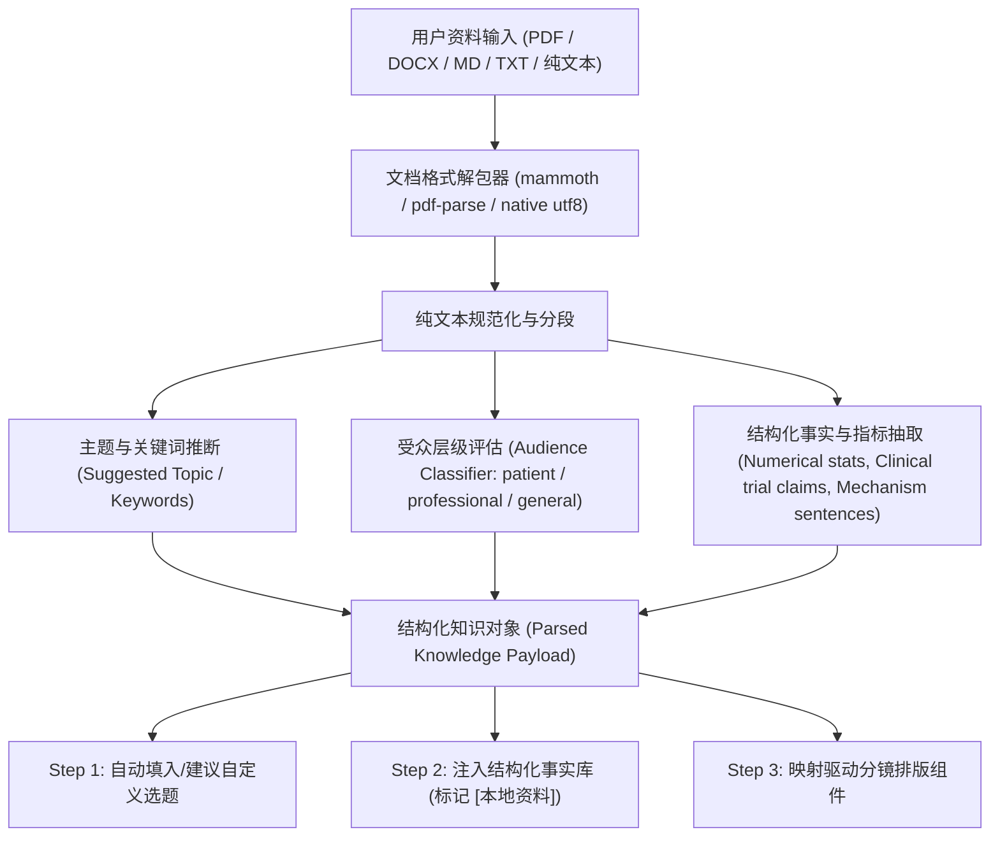

# M8 架构设计规范：用户自定义资料上传与智能文档解析引擎

## 1. 需求与设计目标

### 1.1 背景与痛点
在医学科普、硬核科技与前沿临床视频创作中，用户的选题**绝不是预设固定的几条**，创作者通常自带特定文献、最新临床指南（如 ESC / AHA / 中华医学会指南）、医院宣教单、科研论文摘要（PDF/Word/Markdown/文本）或特定产品器械说明。

用户需要：
1. **完全自由的自定义选题**：输入任何医学、科学或跨领域的主题与创作需求，预设选题仅作为可选的灵感辅助。
2. **多格式参考资料上传**：支持直接上传本地资料文件（`.pdf`、`.docx`、`.md`、`.txt`、`.json`）或直接粘贴长篇指南与论文草稿。
3. **资料智能解析与事实抽取**：系统自动解析上传的资料正文，智能识别与提炼：
   - 核心主题推断与关键词提炼
   - 目标受众与叙事模板倾向性分析
   - 核心医学/科学事实清单（数字指标、临床对比、机理阐述、适应证与禁忌）
4. **全链路深度联动**：
   - 解析出的主题与受众可一键自动回填 Step 1；
   - 提炼出的事实证据作为「本地资料证据」直接注入 Step 2 的 Facts Checklist；
   - 提炼出的机制与数据指标直接喂入 Step 3 的分镜生成器（`waveform`、`stat`、`points` 等组件）产出契合该文档的高保真视频。

---

## 2. 核心架构设计

### 2.1 文档解析与知识抽取模块 (`lib/doc-parser.js`)



#### 解析能力规范：
* **PDF 解析**：采用 `pdf-parse`，支持处理 Uint8Array/Buffer，提取全文文本。
* **Word (DOCX) 解析**：采用 `mammoth.extractRawText`，从 docx 内部 XML 中高精度提取纯文本。
* **Markdown / TXT / JSON**：原生 UTF-8 流解码与 JSON 键值展平。
* **长文本粘贴**：直接接收纯文本字符串。

#### 知识抽取算法（基于临床文献特征规则与结构化提炼）：
1. **主题推断 (`extractSuggestedTopic`)**：
   - 匹配第一行非空标题、文档元数据或前 150 字中的核心疾病/技术术语（如包含“指南”、“共识”、“临床试验”、“消融”、“介入”等）。
2. **受众评估 (`classifyAudience`)**：
   - 统计学术术语（“p值”、“置信区间”、“单中心”、“随机双盲”、“靶点”、“转录组”）与口语大众词汇密度，智能判断为 `patient`、`professional` 或 `general`。
3. **关键证据与事实抽取 (`extractStructuredFacts`)**：
   - **数值与统计指标**：匹配包含百分比、绝对数值、对比指标的句子（例如“有效率达到 85.3%”、“复发率降低 40%”）。
   - **机理与流程语句**：匹配包含“机制”、“穿孔”、“阻滞”、“活化”、“调控”、“步骤”等关键机理动词的句子。
   - **结论与医嘱建议**：匹配包含“建议”、“证实”、“推荐”、“禁用”、“警惕”等断言。
   - 每条事实封装为 `{ claim, statement, evidence: '用户参考资料: ' + filename, verified: true, isUserDoc: true }`。

---

### 2.2 服务端 REST API (`scripts/studio.js`)

* **`POST /api/parse-doc`**：
  - 请求载荷：
    ```json
    {
      "filename": "pfa-guideline.pdf",
      "contentBase64": "JVBERi0xLjQK...", // 二进制文件 base64（PDF / DOCX）
      "textContent": "..."              // 文本文件直接字符串（MD / TXT / 粘贴文本）
    }
    ```
  - 响应结构：
    ```json
    {
      "ok": true,
      "filename": "pfa-guideline.pdf",
      "textLength": 12500,
      "suggestedTopic": "脉冲电场消融在房颤治疗中的临床应用共识",
      "suggestedAudience": "professional",
      "suggestedTemplate": "science",
      "facts": [
        { "claim": "肺静脉电隔离成功率达到 98.2%", "evidence": "用户参考资料: pfa-guideline.pdf", "verified": true, "isUserDoc": true },
        { "claim": "未观察到膈神经永久性麻痹或肺静脉狭窄", "evidence": "用户参考资料: pfa-guideline.pdf", "verified": true, "isUserDoc": true }
      ],
      "summary": "文档聚焦于脉冲电场消融技术在心房颤动导管消融中的临床疗效、安全性指标与操作规范...",
      "keywords": ["心房颤动", "脉冲电场消融", "PFA", "肺静脉隔离"]
    }
    ```

---

### 2.3 前端交互设计 (`lib/studio.html`)

在向导 Step 1 新增 **「自定义资料上传与解析」** 模块：
1. **突出自定义主题输入**：
   - 标题强化为：`视频主题 (自定义输入，支持任意领域)`。
   - 增加快速清空按钮 `[ 清空 ]`，避免用户误以为被预设绑定。
   - 推荐选题 chips 折叠为 `💡 热门权威参考示例 (点击可快速填入)`。
2. **资料上传卡片**：
   - 选项卡 1：`📁 文件上传`（支持拖拽或点击上传 `.pdf`, `.docx`, `.md`, `.txt`）。
   - 选项卡 2：`📝 粘贴资料文本`（支持直接粘贴指南段落、论文 Abstract 或临床笔记）。
   - 点击 `⚡ 智能解析资料` 触发后端解析。
3. **解析反馈与一键应用**：
   - 显示提取结果徽章：`已解析资料: <文件名> (约 4,500 字，提炼出 6 条核心事实)`。
   - 提供 `[ 一键应用资料大纲至向导 ]`：
     - 自动把 `suggestedTopic` 填入主题框；
     - 自动选中推断出的 `audience`；
     - 自动将提炼出的核心事实注入 Step 2，在列表中带有高亮绿色 `[用户资料]` 标识。

---

## 3. 测试与验证策略

1. **单元测试 (`tests/doc-parser.test.js`)**：
   - 纯文本 / Markdown 文本抽取与事实识别
   - DOCX 格式模拟解包测试（mammoth）
   - PDF 格式容错与降级测试
   - 统计数据正则识别（百分比、对照组数据、时间窗口）
   - REST 接口 `/api/parse-doc` 闭环测试
2. **端到端测试**：
   - 上传自定义医学文本 -> 解析提炼事实 -> 生成 Step 3 分镜 -> 一键落地并在工作台成功渲染播放。
3. **回归验证**：
   - 保持全部 194 项既有测试 100% 通过。
